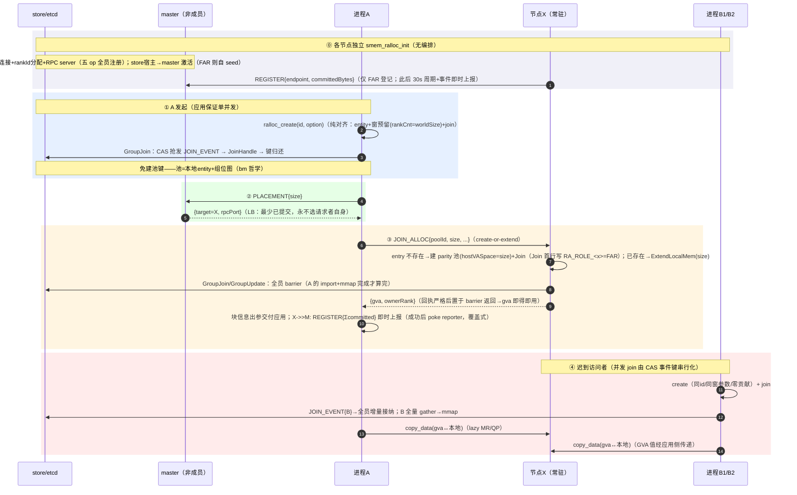
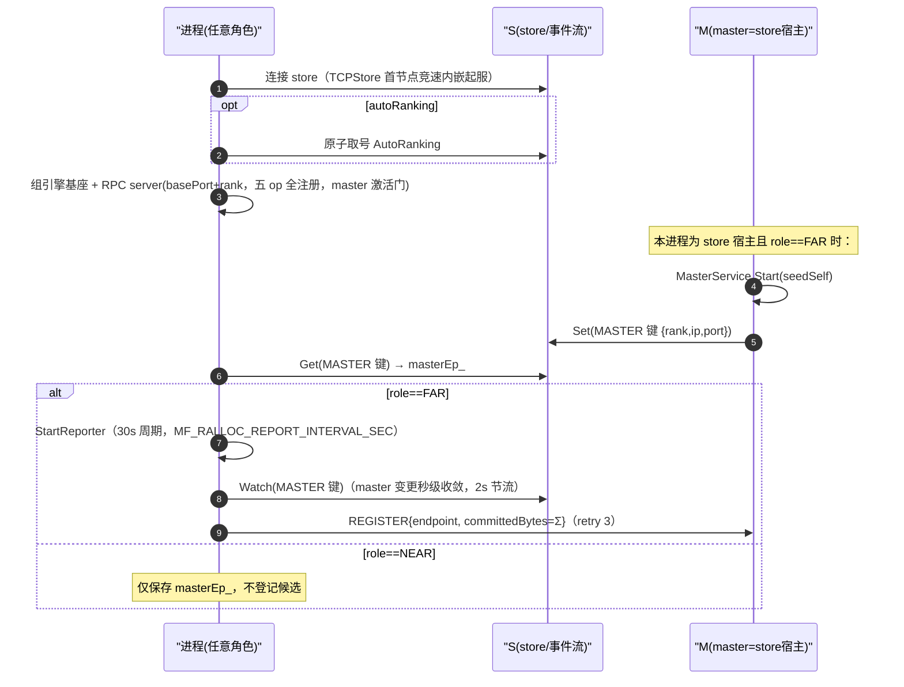
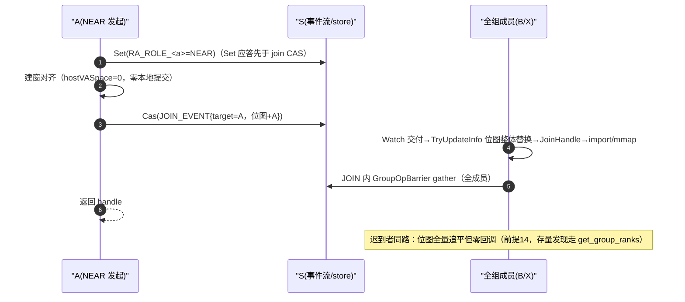
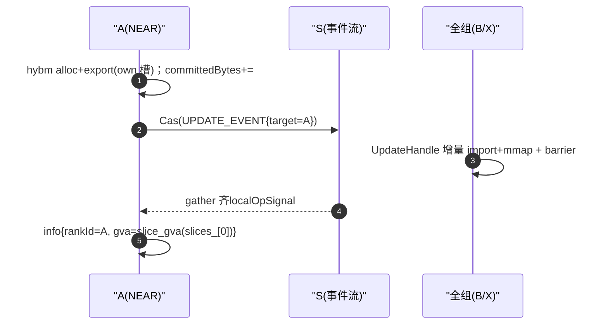
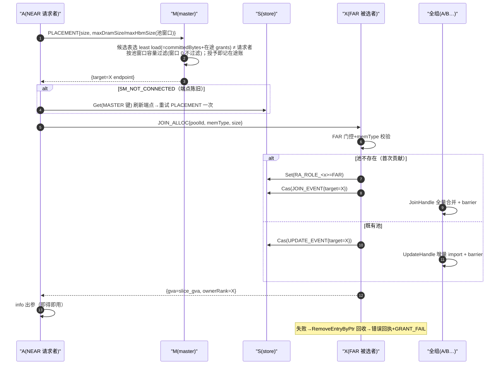
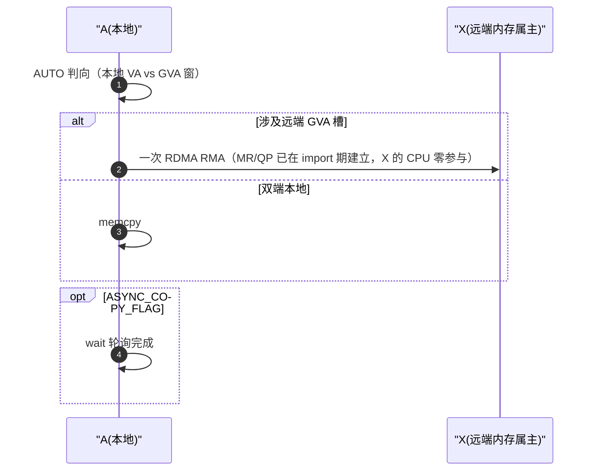
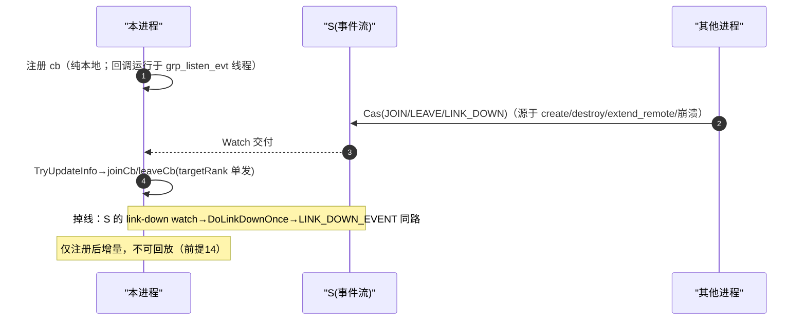
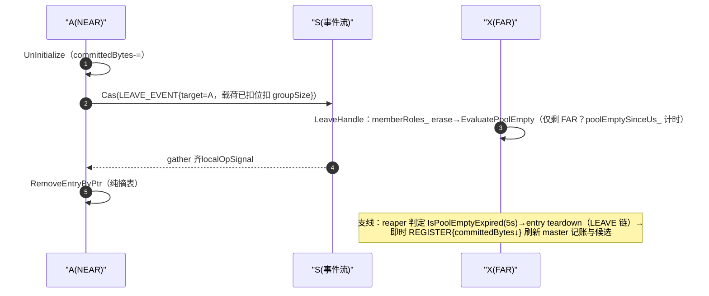
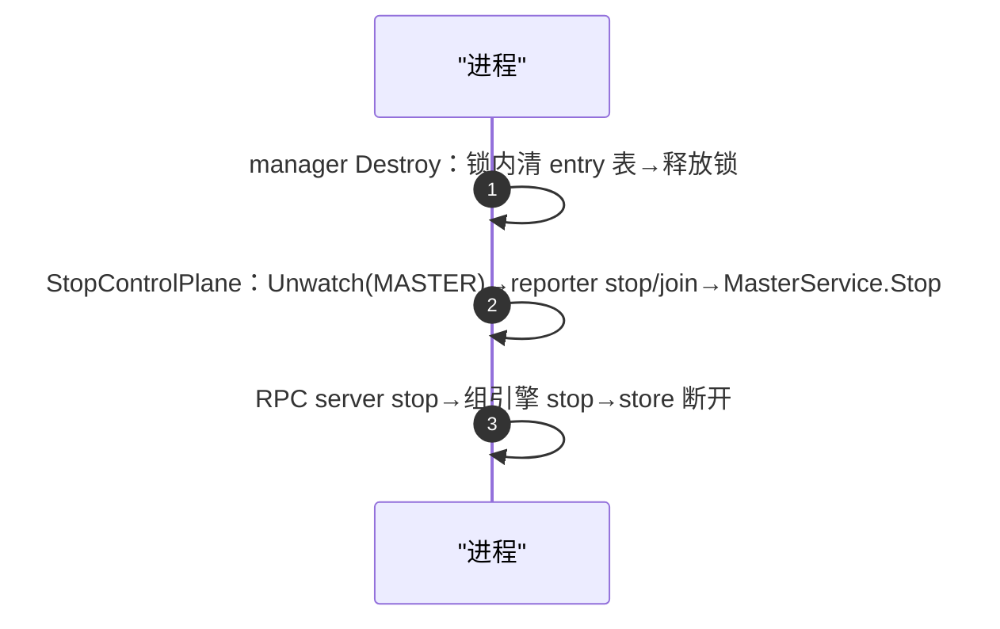

# smem_ralloc 设计文档

> 定位：`src/smem` 下与 smem_bm / smem_shm / smem_trans 平级的入口，**allocation-native 远端内存获取**；
> hybm 引擎仅新增只读区间查询接口（`hybm_query_alloc_ranges`），核心语义零改动；本文档为后续开发需求跟踪基线（需求清单见第 7 节）。

---

## 1. 目标使用模型

```
NEAR 节点 A 调用 ralloc_create（纯对齐：建窗+join，零本地提交）──► extend_remote_mem ──► master 选点
──► FAR 节点 X 贡献内存并 Join ──► 出参 {rankId, gva} 交付 ──► 所有已入组成员（A/B）可直接 copy 访问
支持扩展：NEAR 本地 extend_local_mem / 远端 extend_remote_mem（复用同一 JOIN_ALLOC 闭环）
```

- 无 malloc/free 子分配：**一次获取动作 = 一块内存 = 一个 hybm slice**，统一经 `smem_ralloc_mem_info{rankId, gva}` 出参交付
- **create 纯对齐**：本地零提交、无出参；本地提交入口 = extend_local（NEAR 自己槽）/ JOIN_ALLOC（FAR 被动）
- **库不做块/extent 记账**：应用自持块清单；任意 rank 的当前有效 extent 由 `get_mem_size_by_rank`（hybm 查询+窗内折叠）动态获知
- **entry 生命周期**：NEAR entry = 应用 destroy 显式管理；FAR entry（executor 属有）= 组空自毁（见 §6.5）
- v1 应用保证：首个 create 单并发（内含 join）；仅近端共享访问；B 后续可随时加入

## 2. 节点角色（config.role，默认 FAR）与能力矩阵

| 角色 | create | extend_local | extend_remote | copy/wait/查询/事件 | 登记候选/接受 JOIN_ALLOC |
|---|---|---|---|---|---|
| NEAR | ✅（唯一 handle 途径） | ✅（本地槽提交，不进 master 记账） | ✅ | ✅ | ❌/❌ |
| FAR | ❌（SM_NOT_SUPPORTED） | —（无 handle） | —（无 handle） | —（纯内存供给节点） | ✅/✅ |

- master = store 宿主（显式 rank-0 配置或本地竞速胜者）**激活**（handler 全员注册，见 §4），角色任意：NEAR 可自请求（永不选中自己）；FAR 自 seed 进候选表
- **FAR 的 entry 只能来自 executor（JOIN_ALLOC）**——"FAR entry ⟺ 内部属有"由构造保证，无需属主标记
- 角色经池前缀 store 键 `RA_ROLE_<rank>`（join 前写入）传播，供组空自毁判定（见 §6.5）
- 场景对应：A/B=NEAR，X=FAR；master 可兼任任意角色

## 3. API 面（C，对齐 smem_bm.h 风格）

| API | 说明 |
|---|---|
| `smem_ralloc_init(storeURL, worldSize, deviceId, config)` | 单函数进程初始化（对齐 `smem_bm_init`）：store 连接 + rankId 分配 + 组引擎基座 + RPC server 启动 + store 宿主激活 master（照抄 RacingForStoreServer 模式） |
| `smem_ralloc_create(id, option) → handle` | 纯对齐：建窗+join 融合（bm create2 流程），零本地提交、无出参；仅 NEAR 可调（FAR→SM_NOT_SUPPORTED）；失败路径回收 entry |
| `smem_ralloc_destroy(handle)` | entry 生命周期结束，本地内存全释放 |
| `smem_ralloc_copy(handle, src, dst, size, flags)` / `smem_ralloc_copy_batch` | 直包 hybm data op（AUTO 方向）；batch 为单 wait 多提交 |
| `smem_ralloc_wait(handle)` | SDMA 异步路径收敛（HOST 路径同步完成无需 wait） |
| `smem_ralloc_extend_local_mem(handle, memType, size) → info` | 本地槽扩展一块（bm extend_local_mem 同形+出参；alloc+export+GroupUpdate 闭环） |
| `smem_ralloc_extend_remote_mem(handle, memType, size) → info` | 远端获取一块：PLACEMENT → JOIN_ALLOC（create-or-extend）→ {ownerRank, gva} 出参；memType 与 extend_local 对称（HOST/DEVICE） |
| `smem_ralloc_get_mem_size_by_rank(handle, rank, memType)` | 动态 extent 查询：hybm_query_alloc_ranges 指定介质窗折叠（memType 默认 HOST 向后兼容） |
| `smem_ralloc_get_mem_ptr_by_rank(handle, rank, memType)` | 指定介质窗的槽基址，配对得有效区间 [ptr, ptr+size)，memType 默认 HOST |
| `smem_ralloc_get_group_ranks(handle, rankIds, maxCount)` | 组成员快照枚举（含自身，引擎位图 GetMemberRanks 单次快照）：事件流单槽不可回放（前提 14），注册回调前的存量成员由此发现；满容量按 worldSize 分配，返回实际数（>maxCount=截断可检测），UINT32_MAX=失败 |
| `smem_ralloc_set_group_event_handler(handle, cb, ctx)` / `get_rank_id()` | bm 同形 |

约束：`maxDramSize`/`maxHbmSize`/各 extend size 均 2M 对齐（hybm 大页约束，SMEM_RALLOC_SIZE_ALIGNMENT）；
mem_type 枚举镜像 bm 取值（HOST/DEVICE，见 §11）；双介质池两窗任选其一大于 0 即建对应窗，两窗全 0 拒绝；
**SDMA 位 + DRAM 窗的组合受 GVA_V4 门槛约束**（见 §11.7），device 形态池用 HBM-only 窗。

**56-bit GVA 契约**（`enable_56bits_gva`，`(maxDram+maxHbm)*world > 32TB` 时强制开启）：

- **布局不变式**：GVA 窗口恒为"统一连续基址 + rank×maxSize 偏移"的 span=world×maxSize 整窗；56-bit 仅改变两件事——GVA 基址由 FindFreeSpace 在高位区间内选取，且 **GVA 与 HVA/DVA 解耦**：非 56-bit 下 GVA==HVA（mmap 窗口 VA，CPU 可直访），56-bit 下 GVA 为纯设备侧句柄，本 rank CPU 映射是独立的 LVA 窗。
- **槽位寻址真值化**（算术 → 提交范围查询）：`GetMemPtrByRank`/`GetMemSizeByRank`/`GetRankIdByGva` 经 `QueryWindowRanges`（实体域 `hybm_query_alloc_ranges` 扫全窗 envelope）取提交真值：ptr=该 rank 最低 range 基址、extent=max 末端−基址、rank 判定=包含该地址的 range 的 ownerRank；算术仅保留为 GetRankIdByGva 对"窗内未提交空洞"的兜底（保证拒绝语义完整）。
- **端点契约**：`get_mem_ptr_by_rank`/`extend_*_mem` 返回的 GVA 用于构造 copy_data 端点；56-bit 下不是 CPU 可解引用地址。
- **基址确定性约定**：56-bit 基址为各进程独立 FindFreeSpace 首中——"每进程 GVA 预留序列一致"（当前单池/进程成立）前提下全集群基址一致；多池/多实体且创建顺序不一致的场景需引入跨进程基址协商（远期）。

rankId：**三角色统一由 init 分配**（`autoRanking` 从 store 原子取号 / config 显式），组位图去重兜底。

## 4. 通信面

| 项 | 设计 |
|---|---|
| RPC | acc_links（acc_tcp）封装，进程级单例 server + 帧内 poolId 复用（对齐 hcom 进程单例模式） |
| opcode | `REGISTER{endpoint,committedBytes}`（权威覆盖 + 在途账对账）/ `PLACEMENT{size,maxDram/maxHbm 池窗口}→{target}` / `JOIN_ALLOC{poolId,memType,size,...}→{gva,ownerRank}`（create-or-extend 二合一）/ `GRANT_FAIL`（授予失败回收在途账）/ `PING` |
| wire format | 固定 144B POD（msgVersion=2），magic+version 双检拒绝混部旧版本 |
| handler 注册 | **五 op 全员注册**于 RpcService::Start；REGISTER/PLACEMENT/GRANT_FAIL 仅 master 激活时服务（IsRunning 门，未激活回 SM_NOT_STARTED），PING 恒应答 |
| 端口 | basePort + rankId（默认 11100），错开 store 8572 / hcom 10005 / net 9980 |
| master 候选表 | 内存表：`{rankId → endpoint, committedBytes, 在途 grants}`；**权威覆盖 + 乐观在途**：FAR 上报权威值（Σ entry 提交量），30s 周期 `MF_RALLOC_REPORT_INTERVAL_SEC` + 事件即时触发（master 变更 watch poke / JOIN_ALLOC 成功 poke / 组空自毁后）；PLACEMENT 授予即记在途账（并发请求立刻可见），REGISTER 增长量对账落地账、失败授予主动 GRANT_FAIL 释放 + 90s TTL 过期兜底；请求带池窗口做容量过滤（窗口 0 不过滤） |
| TLS | 复用 acc_tcp_ssl_helper，与 store 开关对齐 |

## 5. 主链路时序



### 5.1 逐 API 多进程交互时序

**约定**：`A`=NEAR 发起者，`B`=NEAR 迟到者，`X`=FAR 贡献者，`M`=master（store 宿主），`S`=配置中心
（承载单槽事件流、MASTER 键、RA_ROLE_ 键）。事件流每条记录 = **全量位图+curEvent+targetRank**，单槽 CAS，
消费即覆盖。可见性契约：JOIN/UPDATE 内 barrier 为全成员 gather ⇒ **发起接口返回 ⇒ 全员 import/mmap 完毕**
（gva 即得即用）。

**图 1：`config_init` / `get_rank_id` / `get_mem_size_by_rank` / `get_mem_ptr_by_rank` / `get_group_ranks`
—— 零跨进程交互**。均为本地查询：rankId init 时定格；extent=本地 hybm 区间折叠；组成员=引擎位图快照。
数据新鲜度 = 本地事件流应用点（eventual consistency）。

**图 2：`smem_ralloc_init`（FAR 视角；NEAR 走 else 分支）**



**图 3：`smem_ralloc_create`**



**图 4：`smem_ralloc_extend_local_mem`**



**图 5：`smem_ralloc_extend_remote_mem`**



**图 6：`smem_ralloc_copy` / `smem_ralloc_wait`**



**图 7：`smem_ralloc_set_group_event_handler`**



**图 8：`smem_ralloc_destroy`**



注：**用户侧 destroy 无即时 REGISTER**（RemoveEntryByPtr 纯摘表），记账新鲜度靠 FAR 周期上报兜底；
仅 FAR 自毁路径（reaper）有即时上报——NEAR 发起方本就无记账，语义自洽。

**图 9：`smem_ralloc_uninit`**



## 6. 扩展场景

**机制基座（现成闭环）**：`ExtendLocalMem` = alloc 新 slice → export → `GroupUpdate`（UPDATE_EVENT）→
全员 `UpdateHandle` 增量 import 最新 slice → re-mmap，失败自动回滚。**块↔slice 天然 1:1，无需区间切分，
亦无需库内记账**。

**可见性契约（重要）**：JOIN/UPDATE 事件内的 GroupOpBarrier 是全成员 gather——发起者返回即所有成员
import+mmap 完毕；executor 回执严格后置于 barrier 返回，因此**获取接口返回后 gva 即查即用**，无需等待环。
`get_mem_size_by_rank` 为当前导入快照（并发中的第三方扩展按 eventual consistency 呈现）。

### 6.5 FAR entry 组空自毁

```
每个 entry 维护 memberRoles_（rank→角色）+ departedRanks_（store 断链确认离线的 rank）：
  · join 前节点在池前缀 store 写 RA_ROLE_<rank>（写先于 join 事件 CAS，次序安全）
  · JoinHandle(rk)：读键入表 + 清自毁标记 + 撤销该 rank 的 departed 记录（重连即复活）；
    自身 join 成功时经 GetMemberRanks() 种子化全表
  · LeaveHandle(rk)（LINK_DOWN 与 LEAVE 共口）：出表后评估
判定（仅 FAR entry）：其余在组成员中剔除 departedRanks_ 后角色全为 FAR（含"无其余成员"）
  → 记 poolEmptySinceUs_；join 进行中（joinActive_）跳过，由 EndJoinActive 收口重估
reaper（manager 周期线程，FAR 节点）：
  · 每周期先对每个 FAR entry 收敛式重估（RefreshPoolEmpty）——事件路径丢标/幽灵成员
    也能在下一周期收敛，不再依赖一次性事件标记
  · FAR entry 且标记超过宽限（默认 5s，MF_RALLOC_POOL_GRACE_SEC）→ UnInitialize(含
    GroupLeave) + RemoveEntryByPtr + 即时上报 master
  · reporter 等待 = min(周期, 最近到期边界)：断链/离开后 poke 立即唤醒，~宽限即回收
断链联动：store WATCH_RANK_LINK_DOWN 回调 → OnRankLinkDown(rank) → 各 FAR entry
  MarkMemberDeparted（入 departed 集、出角色表，纯本地无 rpc）+ poke reporter
```

- **失败 join 的幽灵成员**：垂死 join 在组视图留下幽灵 NEAR 成员且无补偿剔除——departedRanks_ + 断链联动 +
  收敛式重估三者联合兜底：客户端进程退出（store 链断）即被标记离线，~宽限后实体回收
- **多 FAR 同池**（A 两块分置 X1/X2）：A 离开后 {X1,X2} 互见为 FAR → 对称触发、双双回收
- B 仍在则不触发（NEAR 在表）；B 走后才触发；A 崩溃经 LinkDown 与主动 destroy 同路
- 角色键读不到时 fail-safe 按 NEAR 处理（宁漏不误杀）；宽限期内新 NEAR 加入即清标记
- FAR 禁 create ⇒ FAR entry 必为 executor 属有 ⇒ 应用 handle 永不被自毁误杀（无属主标记需求）
- NEAR 的 extend_local 不进 master 记账（候选表只统计 FAR entry 的提交量）

## 7. 需求跟踪清单

| ID | 需求 | 承载机制 | 新增/复用 | 期次 | 状态 |
|---|---|---|---|---|---|
| R1 | 进程初始化（store/rankId/RPC server/master 宿主激活） | `smem_ralloc_init` | 新增（薄） | P1 | 已交付 |
| R2 | A 发起池创建（本地构建+join 融合） | create2 式构建+GroupJoin/JoinHandle | 复用 | P1 | 已交付（纯对齐：零本地提交/无出参/仅 NEAR；失败路径回收 entry） |
| R3 | master 选点（PLACEMENT+LB+候选表） | acc_tcp | 新增 | P1 | 已交付（仅 FAR 登记候选；覆盖式记账=周期+事件即时上报；handler 全员注册+master 激活分离；FAR watch MASTER 键——master 变更秒级重注册（2s 节流）） |
| R4 | 目标节点被动贡献（JOIN_ALLOC create-or-extend） | join 事件机 | 复用+薄执行器 | P1 | 已交付（X 建 parity 池+Join 或既有池 ExtendLocalMem，失败回滚 entry+GRANT_FAIL） |
| R5 | 动态 extent 查询 | hybm_query_alloc_ranges 增量 API+窗内折叠 | 新增（只读查询） | P1.5 | 已交付（`get_mem_size_by_rank`） |
| R6 | GVA 访问 | copy_data+lazy MR/QP | 复用 | P1 | 已交付（AUTO 方向 copy/wait/copy_batch） |
| R7 | 本地扩展 | `extend_local_mem` 闭环 | 复用+薄封装 | P1.5 | 已交付（bm 同形+出参） |
| R8 | 远端同节点扩展 | ~~REMOTE_EXTEND opcode~~ | 并入 R4 | — | 已消解（JOIN_ALLOC create-or-extend 二合一） |
| R9 | B 迟到访问 | create(0)+join 融合；extent 经 `get_mem_size_by_rank` 免费获知 | 复用 | P1.5 | 已交付（存量成员发现经 `get_group_ranks` 补齐） |
| R10 | HBM 介质放开 | ralloc option `maxHbmSize`；extend_* memType 路由；RPC 消息 v2；master 双桶 LB（§11） | 新增 | P3 | 已交付（host/device 双介质池 + extend_local/remote(DEVICE) + copy 往返） |
| R12 | 故障场景（X 掉线/重连、死 FAR 剔除） | master 订阅 store rank-down watch+候选表 lastSeen prune | 新增（薄，store 层零控制逻辑）+复用 | P3 | 已交付（§12：死 FAR 剔除——rank-down watch 秒级剔（主信号）+同节点退避重选（补竞窗）+90s prune（兜底）） |
| R13 | FAR entry 生命周期闭环（组空自毁） | 角色键 RA_ROLE_+memberRoles_+reaper | 新增 | P2 | 已交付（§6.5；宽限 5s/env；FAR 禁 create 免属主标记） |

## 8. 已代码验证的设计前提

1. groupSize 动态（构造起 0，随 join±1）→ A+X 两人起步合法
2. CAS 事件键串行化一切成员变更；GroupJoin 的 BUSY=没抢到键而非等人
3. 迟到加入=JOIN_EVENT→JoinHandle 全量合并；extend 发布=UPDATE_EVENT→UpdateHandle 增量 import
4. Join 超时默认可配（`MF_GROUP_JOIN_MAX_TIMEOUT`），barrier 错误全员传播
5. create 纯本地免互斥；全局状态变更收敛于 join 事件机
6. rankId init 内分配（autoRanking）；master=store 宿主（RacingForStoreServer 竞速或显式 rank-0）
7. 传输层进程单例（HcomTransportManager/hcom driver/端口）→ RPC server 对齐此模式
8. hybm 层仅新增只读查询接口（`HybmVaManager::QueryAllocRanges` / `hybm_query_alloc_ranges`，
   含 `BM_BUFFER_TOO_SMALL` 容量语义与 entity 侧 `QueryRankByGva` 窗布局 rank 解析），核心引擎零改动；
   smem_bm/smem_shm/smem_trans 零侵入
9. JOIN/UPDATE 事件内的 GroupOpBarrier 为全成员 gather：发起者返回 ⇒ 全员 import+mmap 完毕 ⇒
   获取接口出参 gva 即得即用（无需等待环）
10. hostGva_ 为窗基址（rank0 槽基址）；own 槽内地址 = 窗基址+ownRank×maxDRAMSize，首块 gva 必须取
    `hybm_get_slice_gva(slices_[0])` 而非窗基址
11. leave 事件应用先于回调：提交方 ClearBitmapForRank 已在事件载荷内扣位扣 groupSize，接收方
    TryUpdateInfo 整体替换 groupInfo_ 后才调 leaveCb——LeaveHandle 时点 GetMemberRanks()/GetRankSize()
    已扣除离开者；LINK_DOWN 与 LEAVE 共用 leaveCb（崩溃/主动 destroy 同路）
12. 引擎新增公有只读 GetMemberRanks()（shared_lock 走位图，纯增量方法），bm/trans 零影响
13. Destroy 与 reporter 锁序：Destroy 在持锁作用域内清 entry 表后**先释放锁再 join reporter**——reporter 的
    上报/回收路径也取 entry 锁，锁序一致无死环
14. **事件流单槽不可回放**：全组共用单槽 CAS（消费即被下一条覆盖）；初始 Watch 交付仅最新一条记录——
    TryUpdateInfo 整体替换 groupInfo_（全量位图瞬间追平）但 JoinLeaveEventProcess 仅按 curEvent 单
    target 分派 ⇒ **状态可追平、事件不可回放**；注册回调前的存量成员只能经 `get_group_ranks` 枚举发现

## 9. 文件布局

```
src/smem/csrc/smem_ralloc/
  smem_ralloc.cpp                    # C API（init/create/extend/查询/copy）
  smem_ralloc_entry.{h,cpp}          # 编排（三件套模式，无记账）
  smem_ralloc_entry_manager.{h,cpp}
  smem_ralloc_rpc.{h,cpp}            # acc_tcp 封装（REGISTER/PLACEMENT/JOIN_ALLOC/GRANT_FAIL/PING）
  smem_ralloc_master.{h,cpp}         # 候选表+LB+计数
  smem_ralloc_executor.{h,cpp}       # X 侧被动执行器（JOIN_ALLOC create-or-extend）
  smem_ralloc_helper.h               # 枚举/位映射
include/host/smem_ralloc.h           # 公共头
CMake/BUILD 挂载 + python 绑定（pymf_hybrid.cpp RallocPool，memfabric_hybrid.ralloc 子模块）
src/hybm/
  hybm_def.h / hybm_big_mem.h / hybm_big_mem_entry.cpp / mm/hybm_va_manager.{h,cpp}
  / entity/hybm_entity{,_default}.{h,cpp}   # 增量：区间查询 + 窗布局 rank 解析
test/ut/testcase/smem/smem_ralloc_lb_test.cpp   # master LB/GRANT_FAIL + entry bootstrap UT
examples/memory_pool/02_scale_out/04_single_node_multi_process_ralloc、05_multi_node_ralloc
```

## 10. 作废设计存档

| 作废项 | 原因 |
|---|---|
| store 建池键 + first-caller-wins | 应用保证首个 create 单并发 |
| 隐式建池 / B 懒 attach 自动化 | 同上；B 用显式 create(0) 即可 |
| malloc/free + RbtreeRangePool 子分配 | 块↔slice 1:1，无需切分 |
| master 零贡献入组 | 改纯服务，免除 barrier 义务 |
| rankId 动态分配（JOIN_ALLOC 携带） | 统一 init 内分配（bm 一致） |
| **region 记账表**（region_info/AddRegion/QueryRegion/regionId） | 库不记账：获取动作统一 `smem_ralloc_mem_info{rankId,gva}` 出参交付，应用自持块清单 |
| **create 的 policy 枚举**（NONE/LOCAL/REMOTE_AUTO/REMOTE） | create 只管本地构建+join；远端获取独立为 extend_remote_mem，语义正交 |
| **store 发布 per-rank extent** | 动态查询数据源改走 hybm VaManager（订阅路径自动喂入，无需新增同步通道） |
| **extend_remote 的 preferRank 参数** | master LB 唯一路径；后续需要时加参即向前兼容 |
| **extend_remote 返回前的等待环**（轮询 import 追平） | barrier 同步已保证回执时点全员 import 完毕，等待环为死代码 |
| **entry 属主标记（appOwned/executorOwned）** | FAR 禁 create 后"FAR entry ⟺ executor 属有"由构造保证，角色即属主 |
| **槽字节数推导贡献者**（GetMemSizeByRank>0 ⟺ FAR） | 会被 extend_local（NEAR 本地提交）污染；改显式角色键 RA_ROLE_ |
| **master 乐观记账**（PLACEMENT 时 committedBytes += size） | 重引入为**有界在途账**：per-grant 台账（非累加计数），REGISTER 权威值增长对账消减、TTL 过期、失败主动 GRANT_FAIL——旧方案的三问题（计数漂移/destroy 虚高/切主残留）由对账+TTL 消解，同时解决并发冷启动放置压叠同一 FAR |
| **handler 仅 master 注册** | 五 op 全员注册+IsRunning 激活门：master 变更后 handler 不缺位，PING 对任意节点可探活 |

## 11. HBM 双介质支持（v10）

### 11.1 模型（对齐 hybm/bm 一池双介质）

- create(max_dram_size, max_hbm_size)：两窗任选，>0 即预留该介质窗（双开即双介质池）；两窗全 0 → 拒绝（对齐 bm "maxMemorySize is 0"）
- extend_local/remote(mem_type, size)：**单次调用单介质**，块落入该介质的 rank 槽；DEVICE 且池无 HBM 窗 → SM_NOT_SUPPORTED
- GVA 布局双窗并列：host 窗 hostGva_ + rank×maxDRAMSize，device 窗 deviceGva_ + rank×maxHBMSize，各窗基址进程间一致（bm GetPeerDevicePtr 同构）
- **op 位与介质解耦**（对齐 bm，无介质-op 交叉校验）：错配（HBM 窗 + 全 host 位）走 hybm 运行时自然失败；非 NPU 构建下 SDMA/DEVICE_RDMA 位仍被编译守卫拒绝（create 与 executor 两处）

### 11.2 RPC 消息 v2（144B，msgVersion=2）

| 新增字段 | 用途 |
|---|---|
| uint64 maxHbmSize | JOIN_ALLOC：FAR 建池时预留 HBM 窗 |
| uint64 deviceCommittedBytes | REGISTER：DEVICE 介质 committed 记账（size 语义收窄为 HOST committed） |

### 11.3 分介质 LB 记账

- REGISTER 双桶：Candidate{committedBytes(host), deviceCommittedBytes}，权威覆盖上报 + 在途账按介质对账
- PLACEMENT 按请求介质取对应桶（含在途）选 least-loaded，按池窗口容量过滤，仍永不选 requester

### 11.4 分层落点

| 层 | 变更 |
|---|---|
| entry | deviceGva_ 成员；Initialize 双窗口（HBM>0 预留 device 窗，提交仍延迟到 extend，与 host 窗对称）；committedBytes_/deviceCommittedBytes_ 分桶；ExtendLocalMem 按 memType 路由 alloc/export；GetMemPtr/SizeByRank(rank, memType) 与 GetRankIdByGva 真值化（提交范围查询），AddrInHostGva/AddrInDeviceGva 供兜底与属窗判断 |
| executor | JOIN_ALLOC 校验按介质分支（maxHbm/maxDram、LOCAL_HBM/DRAM_SIZE_MAX）；create 分支 TransHybmMemType(maxDram,maxHbm) + 初始 size 按 memType 路由 deviceVASpace/hostVASpace；extend 分支透传 msg.memType |
| master | Candidate 双桶 + OnPlacement 按介质选点（§11.3） |
| create | maxHbmSize 接线、TransHybmMemType、56 位阈值改 (dram+hbm)×rankCount（对齐 bm） |
| 公开 API | smem_ralloc_get_mem_size/ptr_by_rank 增 memType 参数（默认 HOST 向后兼容） |
| python | 同名 mem_type 参数（默认 HOST）；RallocDataOpType 开 py::arithmetic() 支持 SDMA \| DEVICE_RDMA 位组合 |
| 用例 | 04/05 参数化 [host|device]：device 变体 data_op_type=SDMA\|DEVICE_RDMA + copy 后 handle.wait()（SDMA 异步收敛，HOST 路径无 wait） |

### 11.5 假设与边界（v1）

- FAR 节点同构假设：不做 per-node HBM 容量过滤（后续按介质容量/余量扩展）
- 一池双介质窗均全 rank 织造（与 host 窗同构）；非 NPU 构建下 HBM 池在 hybm device alloc 处自然报错（无 create 前置门，对齐 bm）

### 11.6 DRAM×SDMA 互斥约束 = GVA_V4 门槛（机理）

hybm InitDramSegment 在 SDMA 位置位时要求 DRAM 段 CheckSdmaReaches 为真。段分派**不是按 SoC 而是按
GVA version**：`GVA_V4 && 910C && shmFd<0` 才走 VmmBased，否则一律 ConnBased。约束的真界限是驱动代际，
不是芯片：比 V4 旧的驱动会**静默降级**（V3 匹配即 init 成功），只有 SDMA+DRAM 组合在实体初始化时
fail-fast 暴露。

段类型与注册语义（CheckSdmaReaches 分派）：

| 段类型 | 条件 | CheckSdmaReaches | 根因 |
|---|---|---|---|
| HybmConnBasedSegment | 非 V4+910C（含 910B、910C+V3 驱动） | 恒 false（基类默认） | 连接式模型：远端 DRAM 仅 mmap 进本进程 VA，数据走 hcom host 传输；段内无 serverId/superPodId 设备坐标，SDMA 设备引擎无设备侧地址/MR 可用 |
| HybmVmmBasedSegment | GVA_V4 + 910C | 恒 true | 统一编址：host DRAM 进入设备可编址 GVA 空间，SDMA 天然可达 |
| HybmDevLegacySegment（HBM） | — | 按 importMap_ 拓扑判定（同 server/同 superpod） | HBM 有真实设备坐标 |

推论：**GVA_V4 门槛以下的任何环境**"DRAM 窗 + SDMA 位"物理不可实现（fail-fast）；双介质池携带 SDMA 位须
hdk≥25.5.0（V4）。device 变体用例（04/05）因此预留 **HBM-only 窗**（max_dram=0）。

## 12. 故障容错（死 FAR 剔除）

master 宿主在激活时通过 confStore_ 订阅 store 的 `WATCH_RANK_LINK_DOWN`：store 对每条连接做心跳
（超时≈3s），断链即向所有订阅链接推送 rank-down；一次注册持续推送。ralloc rankId ≡ store 连接 rank，
键可直接对用。

| 层 | 触发 | 行为 | 时延 |
|---|---|---|---|
| **rank-down watch**（主信号） | store 断链/心跳超时 → master 回调 `OnRankDown` 擦候选表 | 秒级、全集群生效、零轮询 | ~3s |
| 同节点退避重选（调用内补竞窗） | extend_remote JOIN 连接级失败（SM_NOT_CONNECTED/SM_TIMEOUT）后 placement 仍选中该 rank | 记 failedRank，被重选时 sleep 2s 等 watch 落地再重选，≤4 轮 | 竞窗内 |
| lastSeen prune（兜底卫生） | 每次 OnPlacement | 剔 90s（3×上报周期）未上报候选——watch 丢失/未覆盖也能收敛 | ≤90s |

设计取舍（弃用 requester 主动 EVICT rpc 的原因）：真死场景 watch 全覆盖且更快；**NEAR↔FAR 分区场景**
（FAR 健康、仅请求方不可达）requester 侧 JOIN 超时会误剔健康节点，watch 侧不剔（正确）；误剔自愈路径统一
为下一周期 REGISTER（≤30s）。

实现注意：placement 失败（无 master/无候选）仍立即上抛——同类失败换点无意义。断链信号同时喂组生命周期
（OnRankLinkDown → 各 FAR entry MarkMemberDeparted），解除幽灵成员对组空自毁的阻塞。

**HA store 下的 master 激活**：本版本 master = store server 宿主（tcp:// 显式 rank-0 配置或本地竞速胜者），
在 init 期一次性激活；reg://etcd:// HA 部署下的切主联动（leader 选举回调激活新 master）暂未纳入，
后续需要时在 store 层增加 leader promotion 订阅接口挂接 `ActivateMaster()` 即可（激活源单一，扩展点收敛）。
